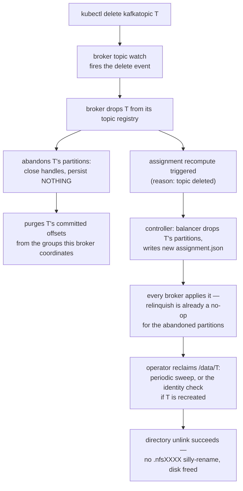

# File-handle ownership & takeover

Only a partition's current leader holds open file descriptors — the rule that makes deletes actually free disk on NFS instead of silly-renaming.

In Apache Kafka, log dirs are broker-local, so file handles are
nobody's problem: every replica holds its own segments open, and
deleting a segment is a local unlink no other machine can observe. On
kaas's shared volume, every broker mounts the *same* partition
directories the [storage hot path](./storage-hot-path.md) writes — and
NFS adds a rule local filesystems don't have: removing a file that any
client still holds open "silly-renames" it into a hidden `.nfsXXXX`
entry that pins the parent directory (`EBUSY` on removal) until every
descriptor closes. Left unmanaged, segment cleanup stops reclaiming
disk and topic deletion loops forever.

kaas's answer extends its single-writer-per-partition model to file
descriptors: **only a partition's current leader holds open log and
index handles**. Every other broker knows the segments as metadata
only — size, base offset, and leader epoch, all readable from the
filename without opening the file. Handles are opened on takeover and
dropped on relinquish or close; even opening a partition at broker
startup only *stats* the segment files.

The payoff is day-to-day, not just in failure cases: segment retention,
`DeleteRecords`, and segment-roll cleanup all unlink files on the
leader — the only broker with the descriptors open — so removal
genuinely frees space instead of leaving `.nfsXXXX` ghosts.

## Takeover and relinquish

When `assignment.json` moves a partition (the
[controller chapter](./controller.md) covers who writes it and why):

- **New leader**: takeover opens the log + index handles, restores the
  idempotent-producer snapshot, and runs segment recovery — scanning
  the active segment forward, verifying each batch's CRC, truncating
  any torn tail to the last valid byte, and reconciling the manifest's
  possibly-stale high watermark against what's actually on disk. Recovery runs at takeover time precisely
  *because* the manifest is allowed to lag (see
  [Storage engine hot path](./storage-hot-path.md)). It then raises the
  partition's epoch to the one the assignment carries, **rolls to a
  fresh segment file stamped with that epoch**, and persists the
  manifest before accepting a single write.
- **Old leader**: relinquish persists the manifest and producer
  snapshot one last time, then closes the handles — unless the manifest
  on disk already carries a higher epoch, in which case it has been
  superseded and writes nothing but still releases its descriptors.

That roll is what makes the epoch-prefixed filenames load-bearing
rather than decorative. A departing leader does not find out it lost
the partition until its own copy of `assignment.json` catches up, so
there is a window where it still believes it leads and keeps accepting
produce requests. Because the new leader appends to a *different* file,
the two can't interleave writes into one — the deposed leader's records
land in a segment belonging to a dead epoch and are discarded, instead
of being spliced byte-wise into the live log. Its produce requests start
failing once its own assignment view catches up.

**That window can lose acknowledged writes.** It lasts up to about a
second plus the NFS attribute-cache TTL, capped at 3 s by the self-fence
only when the move was caused by lost controller connectivity; a move off
a healthy broker never trips the self-fence. A batch acknowledged in the
window sits in the dead-epoch segment at offsets the new leader re-issues.
The new log is never corrupted, but that write is gone. Apache closes its
equivalent window through replication, which kaas doesn't have, and a
Produce request carries no leader epoch to check at any version.

This is the shape Apache Kafka gets from replication and a leader
epoch cache: a follower that becomes leader starts a new epoch, and
records written by the old leader past the divergence point are
truncated away. kaas has no followers to truncate against, so it
separates the writers at the filesystem instead: the same protection for
the log, by a different mechanism.

## Manifest + producer snapshot

Sibling files ride along with every partition's segments:

- `manifest.json` — `(epoch, highWatermark, logStartOffset)`, written
  temp + fsync + rename. Persisted on partition open, takeover and
  close/relinquish, and whenever `DeleteRecords` or retention advances
  the log start — not per append, and not on segment roll — so recovery
  treats the log itself as authoritative for the high watermark.
- `producer-state.snapshot` — the idempotent-producer dedupe window,
  written on takeover and close/relinquish, restored when the partition
  opens. Without it a leadership move would drop the per-producer
  sequence history, and in-flight producer retries would be misclassified
  as `OUT_OF_ORDER_SEQUENCE_NUMBER` instead of duplicates.
- `txn-index.snapshot` — the `read_committed` indexes: open transactions'
  first offsets, which set the last stable offset, and the aborted list.
  Written alongside the producer snapshot and restored on open.
- `recovery-checkpoint.json` — how far the log is known to be fsynced; see
  the [storage hot path](./storage-hot-path.md).

## Topic delete: the handle-close path

Note the asymmetry between *abandon* and *relinquish*. A relinquish is
a leadership handover: persist the manifest and producer snapshot, then
release. A delete is not — the topic is gone, and the operator reclaims
its directory by renaming it aside, so a recreated topic of the same
name gets a **fresh directory at the same path**. A well-meaning close
racing that sequence lands the dead incarnation's high watermark and
dedupe window in the new incarnation's directory. Abandon therefore
drops the handles and writes nothing, and dropping the in-memory
partition forces the next takeover to re-open from disk rather than
keep serving the deleted topic's state.

Both the delete and the recreate arrive on the *same* watch stream, and
the watch finishes handling the delete before it applies anything else, so
the abandon and the offset purge are ordered before the recreate. The cost
is that a slow purge holds up the watch's other topic events while it runs.
(What protects a recreated topic's *directory* even without that ordering
is the topic-identity stamp — see
[the RWX substrate contract](./nfs-substrate.md).)

Removing a topic's committed offsets is Apache's behaviour too, where they
are tombstoned out of `__consumer_offsets`. kaas does it file by file; see
[Consumer-group coordination](./consumer-groups.md#writing-offsets).

## Graceful SIGTERM drain

The broker's shutdown path relinquishes every open partition —
persisting each manifest and producer snapshot one final time **and**
closing the active segment's handles, so the next leader doesn't
inherit a silly-rename fight on takeover.

There is no controlled-shutdown RPC, but the drain is announced:
before teardown the broker sets its drain flag, which rides the next
heartbeat, and the controller moves its partitions off while the
broker is still healthy enough to hand them over — the proactive
"I'm draining" hint, rather than a heartbeat-timeout discovery. See
[Broker fencing](./broker-fencing.md) for the draining state's other
half.

This whole chapter is one discipline in service of a larger contract —
the rules any code touching the shared volume must obey. That contract
is the next chapter: [The RWX substrate contract](./nfs-substrate.md).

## Implementation notes (for contributors)

- The leader-only FD rule is gh #76: `TakeoverDriver` calls the
  engine's take-over, which opens handles before recovery; relinquish
  closes them. Partition open at startup stats without opening.
- `abandon_topic` ≠ `relinquish` (gh #219) — don't "unify" them:
  abandon must close handles and persist **nothing**, or a late close
  writes the dead incarnation's HWM and dedupe window into a recreated
  topic's directory.
- The producer snapshot lives in
  `crates/kaas-storage/src/producer_snapshot.rs`, the transaction indexes'
  in `crates/kaas-storage/src/txn_index_snapshot.rs` (gh #177).
- The stale-leader ack window is gh #164. Closing it would take
  event-driven assignment delivery or a durable-epoch check on first write
  after takeover.
- The whole delete path, with its ordering rules, is written up in
  [Topic delete & recreate](../code-tour/topic-lifecycle.md). The watch
  waiting for the delete is gh #331.
- The SIGTERM drain is in `bins/kaas/src/main.rs` (gh #61, gh #139);
  partition keys are parsed from the right so slash-bearing topic names
  split correctly.
