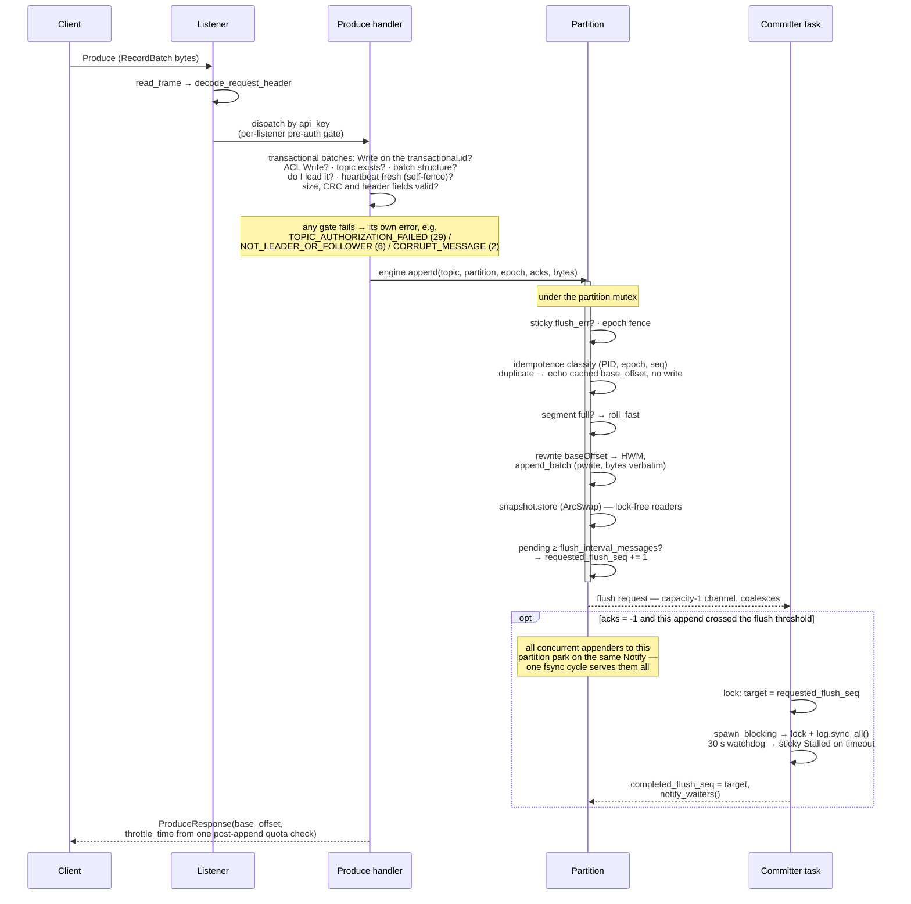
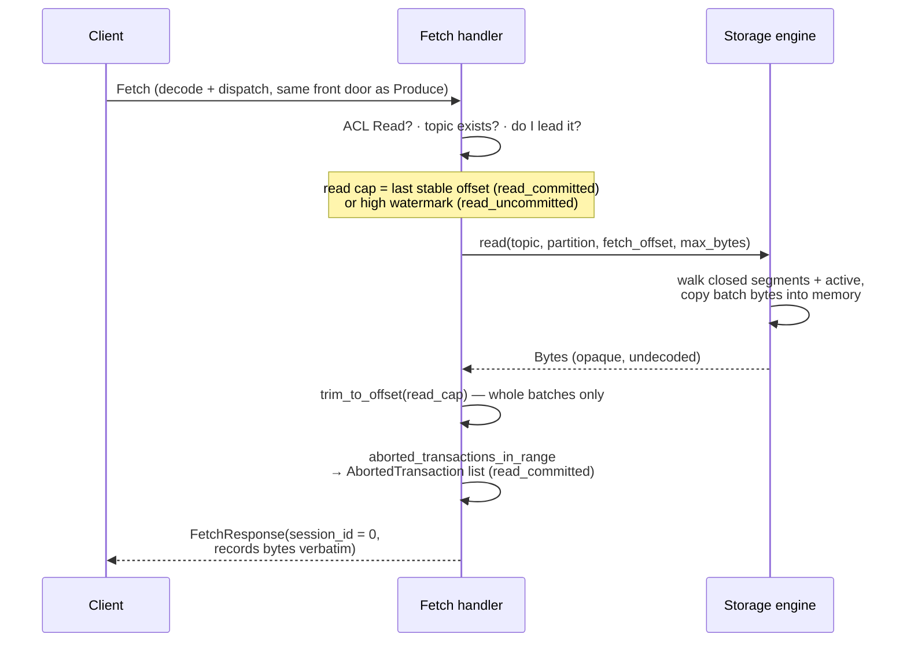
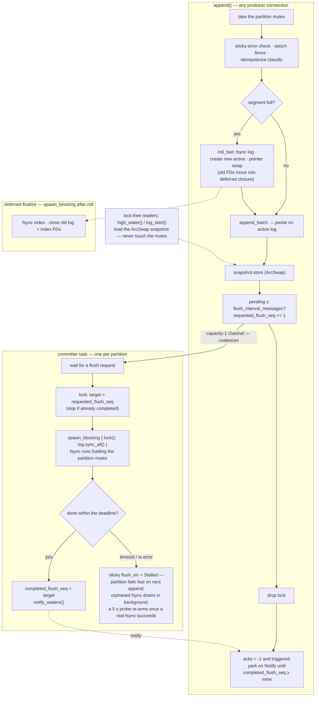

# Storage engine hot path

Group-commit fsync, segment files, the manifest — and how a Produce and a Fetch request travel the broker end to end.

If you know Apache Kafka, you know its produce path leans on two
comfortable assumptions: writes land in the OS page cache, and
durability comes from **replication** — `acks=all` means "on enough
in-sync replicas", not "on disk", which is why almost nobody sets
`log.flush.interval.messages` in production. kaas has neither
assumption available. There are no followers: the only copy of a
partition lives on a shared `ReadWriteMany` volume (the ground rules
for that bet are [the RWX substrate contract](./nfs-substrate.md)), so
`acks=all` has to mean *fsynced to that volume* — and on an NFS-class
mount, every fsync is a COMMIT round-trip over the network. That
round-trip is the dominant cost in the whole broker, and the hot path
is shaped around issuing as few of them as possible: one fsync per
**group** of concurrent batches, an index that is never fsynced on the
hot path, and a manifest that is almost never rewritten.

## A Produce request, end to end



Records inside a batch are never parsed on this path. The handler reads
the fixed-size batch header and checks the batch's CRC32C before anything
is appended, as Apache's append path does: a bad CRC must never be acked,
because the recovery scan stops at it and would truncate every acked
record written after it. The same opaque bytes the client sent then land
verbatim on disk. A duplicate writes nothing, but at `acks=all` it still
waits for any flush outstanding, so a client retrying on a new connection
can't be acked ahead of the original's fsync. The quota check runs once
per request over the summed byte count, after the appends, and feeds
`throttle_time_ms`. An `acks=0` request gets no response, and its connection
is closed instead if any partition failed.

## A Fetch request, end to end



Two response-shape facts:

- **Stateless fetch sessions**: `session_id = 0` on every response —
  Apache's documented contract for "broker doesn't support sessions",
  so clients fall back to full Fetch data per request. KIP-227
  incremental sessions are a future optimisation, not a correctness
  gap.
- **The response is materialized bytes**, copied from the segment
  files; a `sendfile`/splice zero-copy path is a future optimisation
  (the codec keeps records byte-opaque exactly so that a splice path
  stays possible).

## Concurrency model: inside one Partition

What runs under the partition mutex, what the per-partition committer
task does, and what segment roll defers to a background task:



Four properties that make this work:

1. **Group commit**: N concurrent appenders share one fsync cycle — the
   capacity-1 flush channel coalesces requests, and every waiter with
   `flush_seq ≤ completed` wakes on the same `notify_waiters()`.
2. **Lock-free reads**: high-watermark / log-start observation goes
   through the `ArcSwap` snapshot, so a stuck NFS fsync can't stall
   metrics callbacks.
3. **Fsync watchdog**: a hung NFS server trips the timeout (30 s by
   default, `broker.fsyncMaxLatencyMs`), sets a sticky `Stalled` error, and
   the partition fails fast instead of hanging appenders forever. It isn't
   permanent: every 5 s the committer probes the volume, and once a real
   fsync of the log succeeds the partition re-arms, with no restart or
   leadership move.
4. **A failed fsync stalls too, wherever it happens** (gh #289): the two
   segment rolls sync the descriptor the committer syncs, and Linux reports
   a writeback error once per descriptor, so the next fsync succeeds without
   the failed bytes having reached the disk. An appender waiting on a flush
   a failed sync covered gets `Stalled`, never an ack, even if it wakes after
   the partition has re-armed.

Note the committer holds the partition mutex for the fsync window
(readers are unaffected via the ArcSwap; concurrent appenders queue on
the lock). Fsyncing a cloned FD outside the mutex was built, measured,
and deliberately **reverted**: it moved no throughput (the produce
ceiling is set by write round-trips, not the lock — see
[Performance](../operations/performance.md)) and it made a subtle
invariant durability-critical — the flush sequence published to
waiting producers had to be the one sampled *before* the sync. Don't
rebuild it without new evidence.

## On-disk layout

```text
/data/__cluster/                  ── cluster-wide files
    assignment.json
    credentials.json
    acls.json
    txn_state/
        slot-0.json               ── 50 slots, hash(transactional_id) % 50
        ...
    producer_fences/
        from-kaas-0.json          ── one per broker; cross-broker producer
        ...                          epoch fence broadcast
    producer_ids/
        kaas-0.json               ── per-broker producer-ID block high-water
    marker_queue/
        to-kaas-1/                ── per-broker txn marker inbox
            <pid>-<epoch>.json
    __consumer_offsets/
        <group_id>.json           ── per-group offset file

/data/<topic>/
    .config.json                  ── operator-written; retention / segment
                                     bytes / compaction knobs
    .topic-id.json                ── topic-incarnation stamp (see the
                                     substrate contract chapter)

/data/<topic>/<partition>/
    manifest.json                 ── { epoch, highWatermark, logStartOffset }
    producer-state.snapshot       ── idempotent-producer dedupe window
    recovery-checkpoint.json      ── fsynced-prefix hint (see below)
    txn-index.snapshot            ── read_committed indexes (open txns,
                                     aborted list)
    00000005-00000000000000000000.log   ── epoch=5, base_offset=0
    00000005-00000000000000000000.index ──   8-byte (rel_offset, file_pos)
    00000005-00000000000000001000.log   ── epoch=5, base_offset=1000
    ...
```

(With a [volume pool](./volume-pool.md), a topic bound to a pool
volume keeps this exact layout under `/vols/<name>/` instead of
`/data/`; the topic-level `.config.json` / `.topic-id.json` are
written per involved root.)

`__cluster/` is the cluster-state directory — kaas's file-shaped
replacement for Kafka's internal topics. It can live on its own volume,
separate from topic data; see
[the RWX substrate contract](./nfs-substrate.md).

Each segment is a pair of files; the filename carries both the **leader
epoch** and the **base offset**, so a stale ex-leader's writes can
never physically collide with a new leader's segment:

```text
{epoch:08x}-{base_offset:020d}.log     ── append-only log of v2 RecordBatches
{epoch:08x}-{base_offset:020d}.index   ── sparse offset index, 8 bytes/entry
```

The manifest is written on partition open (takeover routes through
open), on close/relinquish, and when `DeleteRecords` or retention advances
the log start — **not** on segment roll and not per append — so its
`highWatermark` can lag in-memory state; recovery treats the log as
authoritative and reconciles on open. A log-start advance is durable
before the request is answered and before any segment file goes, so
purged records stay purged across a crash. The one exception is a full
volume: writing the manifest needs a free block, so on `ENOSPC` the covered
segments go first, or neither `DeleteRecords` nor retention could ever free
the volume. Open makes that safe by clamping the log start to the first
segment's base, as Apache's `LogLoader` does. A manifest with no segments
left is handled the same way: the new segment starts at the log start, not
at the manifest's stale high watermark, so a partition can't advertise
offsets nothing backs. The recovery
scan validates each batch against its own CRC32C and stops at the
first batch that is short, structurally impossible, or fails its
checksum; the log is then **truncated to the last valid byte** before
any write handle is used, so a torn tail from a crash can never be
appended past (which would strand acknowledged records behind
unparseable garbage). Truncation only ever removes bytes the scan
proved unparseable — a clean log is never touched. Who runs that
recovery, and when, is the next chapter —
[file-handle ownership & takeover](./file-handles.md).

### Recovery checkpoint — scanning only the tail

Re-scanning the whole active segment on every takeover is the dominant
cost of broker startup on NFS (O(active segment) at the substrate's
read bandwidth). A per-partition **recovery checkpoint** — Kafka's
recovery-point idea — bounds it. `recovery-checkpoint.json` records
`{segment_base, byte_pos, last_batch_pos, last_batch_crc}`: everything
up to `byte_pos` of the named active segment is fsynced, and the last
batch before it starts at `last_batch_pos` and carries `last_batch_crc`. The committer refreshes it once the fsynced
log grows a threshold (64 MiB) past the last one, and a clean close
writes it at EOF. On open, recovery resumes the scan on the batch at
`last_batch_pos` instead of byte 0 whenever the checkpoint still names
the current active segment and the batch there carries
`last_batch_crc` (position alone could land on a batch-shaped record
payload), and keeps the result only if the scan parses cleanly at least
as far as `byte_pos`. Otherwise (a roll
happened since, the file is missing/stale/truncated, or its positions
don't fall on this log's batches) it falls back to a full scan — always
correct, and cheap with a bounded segment size.

The clean-shutdown fast path falls out for free and on **one** code
path: a graceful close leaves the checkpoint at EOF, so the resumed
scan reads one batch — the same path a crash takes, which scans only
the gap. The checkpoint carries no offsets (gh #230): the high
watermark always comes from batch headers the scan reads, so a missing
or wrong checkpoint costs a full scan and nothing else. Until gh #230
it carried the watermark, recovery trusted it, and a stale checkpoint
that named this segment but landed mid-batch made the resumed scan stop
"torn" at once — so the torn-tail truncation cut acked batches off the
log at that position. What remains trusted is the prefix before the
checkpointed batch: corruption there is not detected. A fenced
leader's close still skips writing a checkpoint, since the directory
belongs to its successor.

### Transaction and producer state — the log decides

`producer-state.snapshot` and `txn-index.snapshot` are written at takeover,
at close and every 64 MiB of log, so after an unclean stop they lag the log.
Each records what it covers: an offset, a byte position that saves walking
the segment, and the writer's epoch. On open, the partition starts from a
snapshot that checks out and replays the batch headers after it through the
same bookkeeping `append` uses. So after a crash `read_committed` consumers
still see the last stable offset held at an open transaction, the aborted
list still filters aborted records, and a retry of an acked batch is still
answered as a duplicate.

With no usable snapshot the indexes are rebuilt from log start, which is what
Apache does for a log with no producer snapshot. That covers a file from before
this field existed, one that doesn't parse, one written by a fenced leader, one
that covers offsets below log start, and one past the end of the recovered log.
That last kind is also removed: a restart at the same epoch writes no snapshot,
so otherwise the log could regrow past it and it would pass for a good one. The
window is kept through a rebuild, because it's all that's left for a producer
whose batches have aged out, and only entries past the log end are dropped.

A crash replays at most about 64 MiB of headers, or a whole log the first time
it rebuilds from log start. Only headers are read, so a log with large batches
costs one read per batch. The one thing not recovered: a cross-partition epoch
fence lives in memory until the next snapshot, so a crash can lose it on a
partition the producer's new session hasn't written to yet.

The index is **sparse**: one `(rel_offset: i32, file_pos: i32)` entry
every `index.interval.bytes` of log data (4 KiB default). Lookup
binary-searches to the closest entry ≤ the target offset, then scans
the log forward. The index is *not* fsynced on the hot path — it's
rebuildable from the log during takeover recovery, so only the log's
durability is on the `acks=all` promise.

## Byte opacity: the broker never parses records

Four places on the Produce path touch the RecordBatch bytes, and none of
them decodes a record:

1. The request decoder carries the records as an opaque, zero-copy
   slice into the frame buffer.
2. The handler validates the batch the way Apache's append path does: the
   fixed-size header fields, plus a CRC32C over the batch's bytes. A
   checksum reads the bytes without interpreting them.
3. The idempotence check peeks the fixed-size batch header for producer
   ID / epoch / sequence — header only.
4. The segment append peeks the head for
   `(base_offset, last_offset_delta, max_timestamp)` — header only.

After that, the same opaque bytes the client sent land verbatim on disk
(with the base offset rewritten in place): **the log file IS the wire
format**, which is what makes Fetch a byte copy rather than a
re-encode. Fetch is symmetric — batch bytes come back off disk
undecoded. What holds the invariant is structural (there is no record
type to decode into) plus byte-identity tests on the disk engine and over
the wire. No metric watches it (see [Observability](./observability.md),
gh #275).

## The durability dial

`KAAS_FLUSH_INTERVAL_MESSAGES` (default **1** = honest `acks=all`:
every batch waits for a group-commit fsync cycle) mirrors Apache
Kafka's `log.flush.interval.messages`. Raising it trades durability for
throughput by letting the committer skip cycles until N messages are
pending — same semantics, same trade, as Apache. A topic can override it
with `flushMessages` in `spec.config`, where `0` means fsync only at segment
roll. On NFS substrates
where the COMMIT round-trip dominates, this and the group-commit
coalescing are the two levers that matter (see
[Performance](../operations/performance.md)).

## Retention, DeleteRecords, and compaction — the honest state

Per-topic policy flows from `KafkaTopic.spec.config` through the
operator-written `.config.json` into the broker, where a background
cleaner enforces it:

- **Retention** runs on a timer (five minutes by default, the same
  cadence and meaning as Apache's `log.retention.check.interval.ms`).
  Each pass drops closed segments that have aged past `retention.ms` or
  pushed the partition over `retention.bytes`, whichever reaps more.
  A topic that sets neither gets the cluster default — seven days,
  as in Apache. `-1` on either knob opts out and retains forever. The
  active segment is never reclaimed, and a partition that can't persist
  doesn't stop the pass for the others. Retention only runs when the
  topic's `cleanup.policy` includes `delete`, as in Apache. kaas has no
  compactor yet (tracked as gh #158), so a `compact` topic keeps every
  record and its disk use only grows. A `.config.json` the sweep can't read
  deletes nothing for that pass, because the topic might be `compact` or
  `retention.ms=-1`.
- **Segment rolls** happen at `segment.bytes` (1 GiB) or `segment.ms`
  (seven days), whichever comes first, per topic. The time-based roll
  is not a detail: retention only ever deletes *closed* segments, so a
  topic that never fills a segment would otherwise keep everything
  regardless of its retention setting.
- **`DeleteRecords`** (API key 21) reclaims on demand rather than on a
  timer: it advances `logStartOffset` to a caller-chosen point and
  unlinks the closed segments that point fully covers. Topic deletion
  is the third path.
- **Compaction** is still missing. Its knobs `min.compaction.lag.ms` (KIP-58) and
  `delete.retention.ms` (KIP-354) round-trip through CRs and
  DescribeConfigs but gate nothing yet. When the compactor lands,
  tombstone expiry will be **per-batch** (Apache is per-record) — a
  deliberate consequence of never opening batches. Status is tracked
  honestly on the [KIP-58](../compat/kip/kip-58.md) and
  [KIP-354](../compat/kip/kip-354.md) pages.

### Why a quiet topic used to keep everything

A subtlety worth stating plainly, because it makes retention look
broken when it isn't: **retention can only delete closed segments.**
The segment currently being written is off limits — Kafka works the
same way — so a topic only starts reclaiming space once it has rolled
at least one segment behind it.

That is why `segment.ms` matters as much as `retention.ms`. A topic
producing a few KB a minute will not reach a 1 GiB segment this decade.
Without a time-based roll it has exactly one segment, that segment is
the active one, and no retention setting can touch it — the topic grows
forever while `kafka-configs.sh` cheerfully reports a 24-hour
retention. With `segment.ms` at seven days, the same topic rolls weekly
and its retention applies from then on.

Both knobs are per topic and both apply to a live log: changing them
takes effect within one sweep, without restarting a broker.

### How old is a segment?

Time-based retention has to answer that per segment, and the answer is
less obvious than it looks. Apache keeps a *time index* alongside each
segment and reads the largest record timestamp out of it. kaas has no
time index, and its manifest — the small JSON file beside a partition's
segments — records the epoch, high watermark and log start offset, but
no per-segment list. So there is nowhere on disk for a segment's
largest timestamp to live.

kaas therefore uses the timestamp it *does* know for free. While a
segment is being written, the broker tracks the largest record
timestamp it has seen, and stamps that onto the segment when it rolls
closed. A segment closed by this broker, in this process, is dated by
its records — exactly like Apache.

Everything else is dated by the log file's **modification time**. That
covers every segment a broker inherits when it restarts or takes a
partition over from a peer. It is the same fallback Apache uses when a
segment has no usable timestamp, and it is well-behaved here: a closed
segment is never written again, so its mtime stops moving the moment it
rolls.

The practical difference is small but worth knowing: a producer that
back-dates its records — setting timestamps far in the past — will see
them aged out promptly by the broker that wrote them, and aged by
wall-clock arrival time by a broker that inherited them.

Retention only ever runs on the broker that **leads** the partition.
This is not an optimisation: on a shared volume, a second broker
deleting the same segments is a data race, and deleting a file another
broker still holds open doesn't free the space at all — the filesystem
just renames it out of the way. See [file-handle
ownership](./file-handles.md).

## Implementation notes (for contributors)

- Issue trail: the group-commit Produce path is gh #80/#81/#82; the
  lock-free ArcSwap read path is gh #134; the 30 s fsync watchdog is
  gh #95; stateless fetch sessions are gh #4; wiring the retention
  cleaner's interval loop was gh #250, and the compactor is still open
  on gh #158.
- Byte-opacity peeks: `kaas-storage/src/idempotence.rs` (PID / epoch /
  sequence) and `kaas-storage/src/segment.rs` (offsets / timestamp);
  the codec side is `kaas-codec` decoding
  `records: Option<bytes::Bytes>` as a zero-copy slice. Guarded by
  `append_then_read_byte_identical` in `crates/kaas-storage/src/disk.rs`,
  `append_then_read_back_is_byte_identical` in
  `crates/kaas-storage/src/segment.rs`, and the Produce → Fetch byte
  comparison in `bins/kaas/tests/smoke.rs`.
- Topic-config plumbing: `crates/kaas-storage/src/topicconfig.rs`;
  `RetentionCleaner` and its policy sources:
  `crates/kaas-storage/src/cleaner.rs`; the interval loop and the
  leadership gate: `bins/kaas/src/main.rs`.
- The producer-fence files and marker queue in the layout above belong
  to the transaction machinery (gh #108 phase 2, gh #175) — see
  [Transactions & idempotence](./transactions.md).
- Fixes worth reading before touching this path: the durable log-start
  advance and the full-volume exception (gh #311, gh #325), re-arming after
  a stall (gh #168), a manifest with no segments (gh #229), duplicates
  waiting for the fsync (gh #321), and the CRC check on append (gh #228).
  Produce can still park a runtime worker on the partition mutex for up to
  one fsync (gh #333).
- The index is read into memory on open; an mmap-backed index is
  future work noted in `segment.rs` (the workspace forbids unsafe
  code, so it would need a vetted dependency).
