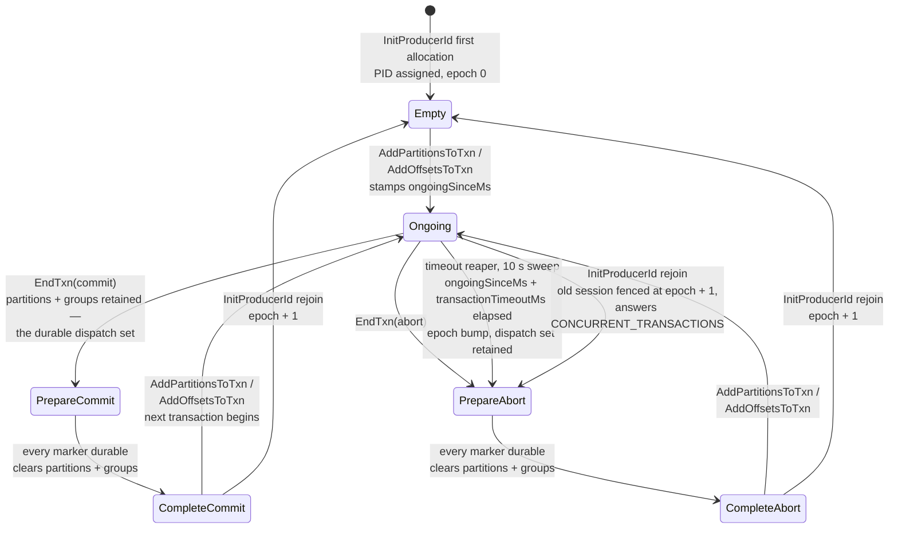
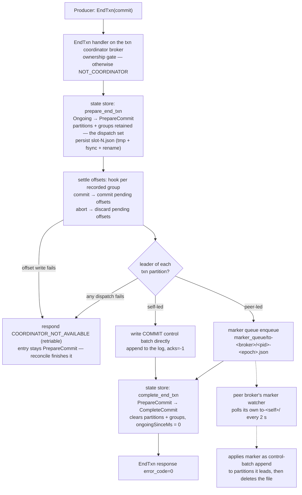

# Transactions & idempotence

Idempotent-producer dedupe, the transaction coordinator state machine on slot-sharded JSON files, and EOS v2 end to end.

In Apache Kafka, exactly-once rests on two pieces of broker machinery:
per-partition producer state (the idempotence dedupe window) and a
transaction coordinator whose state lives in the internal
`__transaction_state` topic. kaas keeps the first nearly verbatim and
replaces the second: there is no `__transaction_state` topic. Like
`__consumer_offsets`
([Consumer-group coordination](./consumer-groups.md)), it is an
internal topic replaced by plain JSON files on the shared volume — the
third substitution from the [introduction](../introduction.md).

None of this is exotic. The Java producer has enabled idempotence by
default since Kafka 3.0, so *every* `kafka-console-producer` invocation
exercises this machinery — it's hot-path, not an opt-in feature. Four
layers of state, all on the shared volume:

| Layer | Where it lives |
|---|---|
| PID allocation (`InitProducerId`) | a persisted block allocator, one file per broker under `/data/__cluster/producer_ids/`; transactional IDs get the same PID + `epoch+1` on rejoin |
| Per-partition dedupe | a 5-batch ring per PID, held in memory under the partition mutex |
| Snapshot persistence | `producer-state.snapshot` next to the partition manifest |
| Per-`transactional.id` state | slot-sharded `/data/__cluster/txn_state/slot-N.json` |

## Idempotent producer

`InitProducerId` (key 22) hands a non-transactional producer a fresh PID
at epoch 0. On every Produce, classification runs **under the partition
mutex, before append** against a per-PID ring of the last 5 batches —
mirroring the Java client's `max.in.flight.requests.per.connection=5`:

- **duplicate** → echo the cached `baseOffset`, no log write (at
  `acks=all` it first waits for any flush still outstanding);
- **out-of-order sequence** → error 45 (`OUT_OF_ORDER_SEQUENCE_NUMBER`);
- **stale epoch** → error 47 (`INVALID_PRODUCER_EPOCH`);
- otherwise accept and advance the ring.

Sequences wrap from `i32::MAX` to 0, and a PID with no state accepts any
sequence, both as in Apache. That second rule matters for a live producer
whose entry has expired or whose records have been deleted.

The ring survives leadership moves via `producer-state.snapshot`
(written on take-over + relinquish, restored on open — see
[File-handle ownership](./file-handles.md)).

### PIDs are never reused

The dedupe ring is keyed by `(PID, epoch)`, so handing the same PID to
two different producers is not a cosmetic collision — the second one
inherits the first one's sequence history. Its batches are then either
**silently dropped** (sequence range matches a cached batch → classified
duplicate, stale base offset echoed, produce "succeeds", consumers read
nothing) or **rejected** with `OUT_OF_ORDER_SEQUENCE_NUMBER`. Both
failure modes have been observed in practice.

Apache Kafka draws PIDs from a global counter whose next block is
persisted (ZooKeeper's `/latest_producer_id_block`, KRaft's
`ProducerIdsRecord`). kaas has no metadata quorum (a stated
[non-goal](../compat/non-goals.md)), so it partitions the PID space by
broker ordinal instead:

```text
pid = (broker_id + 1) * 2^40 + local
```

Each broker is the single writer of its own slice *and* of its own
block file `/data/__cluster/producer_ids/kaas-<id>.json`, so there is
no cross-broker read-modify-write on the shared volume. `local`
advances in blocks of 1000, and the block end is persisted (tmp +
fsync + rename) **before** any PID in it is handed out — a crash can
only skip PIDs forward, never rewind. The `+ 1` keeps broker 0 clear of
the low PIDs an earlier in-memory allocator handed out, so an upgrade
can't collide with producer state already on the volume.

### Fencing across partitions and brokers

A transactional producer that reconnects gets the **same PID with
`epoch+1`** — fencing is the monotonic epoch, exactly Apache's KIP-360
contract. A v3+ request that carries the producer's claimed identity is
checked first: a stale claim gets `PRODUCER_FENCED` instead of a newer
epoch, and a retry of a claimed bump gets the same answer back (details
on the [KIP-360 page](../compat/kip/kip-360.md)). Two mechanisms make the
bump stick everywhere:

- **Cross-partition fence**: after every `epoch > 0` rejoin, the
  InitProducerId handler walks every local partition, advances the
  PID's epoch and clears its dedupe window — so a zombie batch from the
  old session is fenced even on partitions the new session hasn't
  touched yet.
- **Cross-broker fence broadcast**: the bump is appended to a
  per-broker fence log under `/data/__cluster/producer_fences/`; every
  peer polls the logs and applies the bumps it hasn't seen. Same
  shared-volume pattern as the marker queue below — no new RPC surface.

## Transaction state machine

Per-`transactional.id` state is slot-sharded across
`/data/__cluster/txn_state/slot-N.json` (50 slots,
`fnv1a(transactional.id) % 50` — the same 50 Apache Kafka defaults to
for `transaction.state.log.num.partitions`). The states a transaction
actually visits:



Facts the diagram compresses:

- The `Prepare*` states are the durability pivot, exactly as in Apache:
  a prepared entry **keeps its partition and group lists**, and that
  retained list *is* the durable record of "these markers still owe a
  write". A marker-dispatch failure, a coordinator crash, or a producer
  retry all re-derive the identical dispatch set from it; only the
  transition to `Complete*` — taken once every marker is durable —
  clears the lists.
- `InitProducerId` on a **rejoin** keeps the same PID, bumps
  `epoch += 1` and lands the entry in `Empty`. If the entry is `Ongoing`,
  the rejoin aborts that transaction first: `PrepareAbort` at `epoch + 1`
  with its lists kept, ABORT markers written, and `CONCURRENT_TRANSACTIONS`
  back to the client, whose retry then bumps onto the clean entry (gh #201).
  Before that fix the new session inherited the open transaction, and its
  first commit committed the zombie's records too. A rejoin during
  `Prepare*` answers `CONCURRENT_TRANSACTIONS` until the markers land.
  Once the epoch reaches `i16::MAX - 1` the rejoin rotates to a fresh PID
  at epoch 0 instead; the last epoch is kept back for that fence bump.
- A retried `EndTxn` in the matching `Complete*` state is answered
  idempotently (no second transition); a direction mismatch returns
  `INVALID_TXN_STATE`, and `EndTxn` on `Empty` is `INVALID_TXN_STATE`
  too. Epoch mismatches return `PRODUCER_FENCED` everywhere.

## EndTxn: commit flow

Cross-broker marker dispatch goes through a queue on the shared volume —
there is **no** WriteTxnMarkers RPC between brokers. `EndTxn` is
**two-phase**: prepare, settle the staged offsets, dispatch every marker,
then complete. For a
peer-led partition, a durably written queue entry counts as a
dispatched marker (the peer's watcher retries until it applies); a
dispatch failure returns the retriable `COORDINATOR_NOT_AVAILABLE` and
leaves the transaction prepared, so a producer retry — or the
background reconcile below — re-derives the same dispatch set and
finishes the job.



The offsets settle right after the prepare, before any marker, and that
step can fail: a commit whose offsets didn't reach the disk stays prepared
with its groups and answers the retriable error. Settling first means a
failed offset write costs nothing, where placing markers first would
re-append a control batch to every partition on every retry. Showing the
offsets before the markers are durable is safe, because `Prepare*` is the
decision: the transaction can only finish in that direction. The cost is
that while the offset write keeps failing, no marker lands, so the
transaction's partitions keep a pinned last stable offset until it heals.

Self-led markers are written *before* the queue entries, so a
coordinator crash mid-dispatch never loses the local marker. A retried
`EndTxn` overwrites the same `{pid}-{epoch}.json` file — the queue is
idempotent by naming. Consumers in `read_committed` only see the
transaction's records once these markers land (the fetch path clamps to
the last stable offset).

## Coordinator routing and staged offsets

Which broker coordinates a transaction is the same deterministic hash
story as consumer groups: `hash(transactional.id)` picks the slot
owner, and non-coordinators answer the txn APIs with `NOT_COORDINATOR`
— see [Consumer-group coordination](./consumer-groups.md). On
coordinator failover the new owner simply reads the same slot file off
the shared volume: close-to-open consistency means the file *is* the
materialized state, with no log replay — this is the architectural
replacement for Apache's `__transaction_state` topic.

`TxnOffsetCommit` (key 28) stages consumer offsets in a **pending**
layer keyed by `(group ID, PID)` in the offset store — invisible to
`OffsetFetch` until `EndTxn` commits. `AddOffsetsToTxn` (key 25)
records which groups the transaction will touch, so the EndTxn offset
hook knows exactly which pending sets to commit or discard. The hook is
idempotent, since a retry or the reconcile can run it again.

**One gap on multi-broker clusters.** `TxnOffsetCommit` runs on the group's
coordinator, but `EndTxn` runs on the transaction's coordinator and fires
the hook on that broker's own offset store. When the two hash to different
brokers, the staged offsets are never materialised and the group replays
from its last committed offset: duplicates, not loss (tracked as gh #340).
`TxnOffsetCommit` also doesn't check the consumer's generation or the
producer's epoch (tracked as gh #341). See the
[TxnOffsetCommit notes](../compat/api/transactions.md#txnoffsetcommit).

## The timeout reaper and the marker reconcile

The transaction timeout reaper fires every 10 s — Apache's
`transaction.abort.timed.out.transaction.cleanup.interval.ms` default.
Any `Ongoing` entry past `ongoingSinceMs + transactionTimeoutMs`
transitions to **`PrepareAbort`** with an epoch bump — and, crucially,
keeps its partition and group lists: a timed-out transaction owes
ABORT markers exactly like a client-driven abort does.

A **marker reconcile** pass shares the same 10 s tick: it walks every
prepared transaction this broker coordinates, settles its staged offsets
through the offset hook, places the outstanding markers, and runs the
complete transition. The two
halves are complementary, not redundant: the EndTxn handler's inline
dispatch keeps commit latency off the sweep interval, but only the
reconcile can finish a transaction whose producer crashed, was fenced,
or (for a reaper abort) never existed to retry at all. A dispatch that
still fails is left prepared and retried next pass, deliberately
without bound.

Both sweeps are **ownership-gated**: a transaction slot file has
exactly one legal writer — its coordinator — so each broker reaps and
reconciles only the transactions it owns (an ungated sweep would have
every broker read-modify-writing the same slot files on the shared
volume, violating [the substrate rules](./nfs-substrate.md)). The gate
degrades safely at both edges: with no coordinator installed
(dev/single-broker) everything is owned, and in cluster mode nothing
is owned until the first assignment load — which delays a sweep by one
poll rather than skipping it.

## Implementation notes (for contributors)

- Dedupe ring: `crates/kaas-storage/src/idempotence.rs`
  (`ProducerStates`); snapshot persistence:
  `crates/kaas-storage/src/producer_snapshot.rs`.
- PID block allocator: `crates/kaas-broker/src/producer_id.rs`
  (gh #219 — both the silent-drop and the `OUT_OF_ORDER` symptoms of
  PID reuse were seen there; the pre-fix allocator was an in-memory
  `AtomicI64`).
- Fence-on-rejoin contract: gh #22; claimed-identity validation and
  abort-on-rejoin: gh #201 (`TxnStateStore::init_producer_id`, a port of
  Apache's `prepareInitProducerIdTransit`). Cross-broker fence broadcast
  (gh #108 phase 2): fence log in
  `crates/kaas-coordinator/src/fence_log.rs`, applied by each peer's
  `FenceWatcher` (`crates/kaas-broker/src/fence_watcher.rs`).
- Txn state store + slot sharding:
  `crates/kaas-coordinator/src/txn_state.rs` — the architectural answer
  to gh #29 (no literal `__transaction_state` topic).
- Marker queue: gh #175. Txn-slot hash ownership: gh #91. Two-phase
  EndTxn + the marker reconcile: gh #225, shared dispatch in
  `crates/kaas-broker/src/txn_markers.rs` (`reconcile_pending_markers`
  over `TxnStateStore::pending_marker_dispatches`).
- Settling offsets before markers: gh #318
  (`TxnStateStore::settle_offsets`). Sequence wrap and no-state acceptance:
  gh #306. Duplicates waiting for the fsync: gh #321. Store calls stay off
  the runtime workers through `Broker::txn_store_io` (gh #328). A peer
  records a fence as applied only after applying it.
- The reaper and reconcile are spawned by the broker's cluster runtime
  (`bins/kaas/src/cluster.rs`), both gated on `Broker::owns_txn`
  (`abort_overdue_owned` on the store side; the ungated
  `abort_overdue` is tests/dev-mode only).
- The full KIP-447 consume-process-produce-commit round trip runs
  against an in-process broker in `bins/kaas/tests/eos_v2.rs`.
